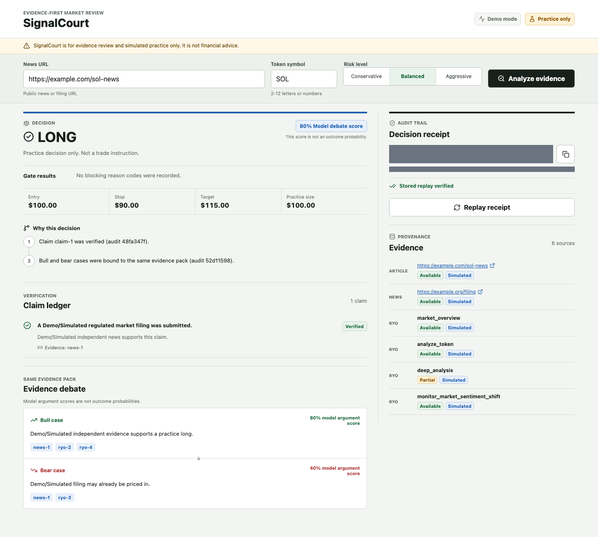

# SignalCourt

[English](README.md) | [中文](README.zh-CN.md)

**Evidence-first review for market-moving crypto news.** SignalCourt turns a public article into a claim ledger, combines independent news with read-only RYO market research, forces Bull and Bear agents to cite the same stored evidence, applies deterministic safety gates, and saves the result as a replayable receipt.

> Practice decisions only. SignalCourt is not financial advice, does not connect to wallets, and cannot execute trades.



## The 30-second case

A headline can be real while still being incomplete, already priced in, or unsupported by current market conditions. Most agent demos hide that uncertainty behind a confident paragraph. SignalCourt makes the uncertainty inspectable:

1. Extract up to three central claims from the article.
2. Search for independent reporting and classify each claim as verified, disputed, or unsupported.
3. Collect current RYO market evidence with explicit timestamps, availability, warnings, and data mode.
4. Ask Bull and Bear agents to argue from one immutable evidence pack.
5. Let deterministic code validate citations, freshness, risk inputs, and decision gates.
6. Return a simulated `LONG`, `SHORT`, or `NO_TRADE`, then replay the stored receipt without calling the network.

The intended judge experience is decision-first: failed gates and provenance are visible before raw payloads, and the complete workflow can be understood in under five minutes.

## Current status

| Surface | Status | What that means |
| --- | --- | --- |
| Demo workflow | Verified locally | Deterministic simulated fixtures run without API keys; unit, integration, and Playwright coverage exercise the workflow. |
| Supported and insufficient-evidence paths | Verified locally | Both paths are covered end to end through the browser, Fastify API, SQLite persistence, and replay endpoint. |
| Receipt replay and integrity | Verified locally | Schema `1.1` receipts recompute evidence and full-receipt hashes before reporting an identical replay. |
| Live-mode wiring | Prepared | Server adapters and fail-closed gates are implemented, but live operation requires all credentials and a reviewed publisher registry. |
| Authenticated RYO call | Not verified in this checkout | The opt-in smoke test is available, but it has not been run without user-provided credentials. |

Demo fixtures are always labelled `simulated`. A prepared adapter or passing fixture test is not presented as proof of a live external service.

## Evidence flow

```text
public article
    |
    +--> claim extraction --> independent-news verification
    |
    +--> RYO research coordinator --> four read-only market tools
                                  |
                                  v
                     immutable evidence pack
                         /             \
                  Bull case         Bear case
                         \             /
                    deterministic judge
                             |
                   LONG / SHORT / NO_TRADE
                             |
              SQLite receipt + offline replay
```

The React/Vite client is an evidence workspace. Fastify owns input validation, outbound adapters, agent orchestration, decision gates, and receipt APIs. SQLite stores append-only receipts for the local project. Credentials remain on the server.

## Why the RYO tools matter

| Tool | Decision role | Required live evidence |
| --- | --- | --- |
| `market_overview` | Establishes the broader market regime so one token headline is not judged in isolation. | Current market availability and a fresh observation timestamp. |
| `analyze_token` | Supplies token price and technical context used by the practice risk plan. | Positive price and ATR inputs, plus market and technical availability. |
| `deep_analysis` | Adds catalysts, risks, and confluence beyond a single indicator. | Primary and derivatives availability with structured catalysts and risks. |
| `monitor_market_sentiment_shift` | Tests whether seven-day sentiment supports or contradicts the headline narrative. | Available sentiment context with a fresh observation timestamp. |

Every RYO result retains its normalized request, `status`, `data_mode`, `as_of`, `availability`, `warnings`, and structured data. Live decisions accept only fresh `live` RYO evidence; simulated or unknown data cannot silently become live evidence.

## Deterministic safety gates

The LLM can extract claims and write evidence-constrained arguments. It cannot approve its own evidence or bypass code-level gates. SignalCourt returns `NO_TRADE` when, among other cases:

- a central claim lacks independent publisher support;
- news duplicates the submitted article or resolves to the same publisher identity;
- required RYO evidence is unavailable, stale, simulated in live mode, or structurally invalid;
- Bull or Bear cites an evidence ID that is not in the stored pack;
- the model response is unavailable or fails its schema;
- price, ATR, or the selected risk profile cannot produce a valid practice risk plan; or
- evidence hashes, claim references, or the causal chain fail integrity checks.

Missing data stays missing. The system does not invent a price, source, timestamp, or market signal to force a position.

## Replayable receipts

Each analysis creates a new immutable receipt containing the claims, evidence, Bull/Bear arguments, deterministic verdict, reason codes, causal chain, and practice-only risk values. Each evidence item has a content hash. The receipt records:

- an evidence-pack SHA-256 hash; and
- a full receipt-integrity SHA-256 hash covering the semantic decision record.

Replay reads the stored receipt, revalidates evidence IDs and hashes, recomputes the deterministic decision and reasons, and compares the integrity hash. It does not call RYO, news search, the article, or the model. Legacy schema `1.0` receipts remain readable, but a legacy receipt without the full integrity hash cannot report an identical replay.

## Quick start: deterministic demo

Prerequisites: Node.js `22.12+` (or a supported version declared in `package.json`) and npm.

```bash
npm ci
npm run dev
```

Open [http://127.0.0.1:5173](http://127.0.0.1:5173). The API listens on `127.0.0.1:8787`. With missing or incomplete live configuration, the server deliberately stays in demo mode. The default demo uses a fixed supported scenario, stores receipts in `./data/signalcourt.sqlite`, and makes no paid external calls.

## Live-mode setup

1. Create a local environment file:

   ```bash
   cp .env.example .env
   ```

2. Set every live credential and replace the example publisher registry with domains you have reviewed.
3. Start the application with `npm run dev` and confirm the header says **Live mode**.

SignalCourt enters live mode only when RYO, Tavily, the OpenAI-compatible model, and the publisher registry are all ready. Partial configuration falls back to demo mode instead of mixing simulated and live evidence.

| Variable | Required for live | Purpose |
| --- | --- | --- |
| `PORT` | No | Fastify port; defaults to `8787`. |
| `DATABASE_PATH` | No | SQLite receipt path; defaults to `./data/signalcourt.sqlite`. |
| `RYO_MCP_URL` | Yes | Authenticated RYO MCP endpoint. Keep the provided default unless RYO instructs otherwise. |
| `RYO_MCP_KEY` | Yes | Server-only RYO credential. |
| `TAVILY_API_KEY` | Yes | Server-only independent-news search credential. |
| `LLM_BASE_URL` | Yes | HTTPS base URL for an OpenAI-compatible model service. |
| `LLM_API_KEY` | Yes | Server-only model credential. |
| `LLM_MODEL` | Yes | Exact model identifier exposed by that service. |
| `PUBLISHER_REGISTRY_JSON` | Yes | JSON map of trusted registrable domains to publisher identities. It must contain at least two domains with two distinct publisher IDs. |

The publisher registry is a trust boundary, not a cosmetic allowlist. Register the base domains that may supply the submitted article and independent search results. Sites owned by the same publisher should share one publisher ID so they cannot satisfy the independence gate twice.

## Commands and verification

| Command | Purpose |
| --- | --- |
| `npm run dev` | Run the Vite client and Fastify API. |
| `npm test` | Run deterministic unit and integration tests; the live smoke remains skipped. |
| `npm run typecheck` | Type-check client and server configurations. |
| `npm run build` | Build the server and production client. |
| `npm run test:e2e` | Run desktop/mobile full-stack flows and visual regression checks. |
| `npm audit` | Audit production and development dependencies. |
| `npm run test:smoke:ryo` | Explicitly enable one authenticated RYO catalog lookup and one `analyze_token` call. |

Run the deterministic verification set:

```bash
npm test
npm run typecheck
npm run build
npm run test:e2e
npm audit
git diff --check
```

The RYO smoke test is deliberately opt-in because it requires a real credential and consumes external quota:

```bash
# Configure RYO_MCP_URL and RYO_MCP_KEY in .env first.
npm run test:smoke:ryo
```

Without `RUN_RYO_SMOKE=1`, the smoke file is collected but skipped. With the flag enabled, missing RYO environment values fail with a clear message. The test never prints the key.

## Competition fit

| Scoring concern | Inspectable SignalCourt evidence |
| --- | --- |
| Multiple sources | Independent publisher evidence plus four distinct RYO research tools. |
| Autonomous reasoning | Verifier, research coordinator, Bull, Bear, and judge roles operate through bounded contracts. |
| Failure handling | Bounded RYO retries, explicit availability, schema checks, freshness checks, and deterministic `NO_TRADE`. |
| Real cause and effect | The claim ledger and causal chain connect each verdict to exact evidence IDs and reason codes. |
| Repeatability | Append-only SQLite receipts replay offline from hashed stored evidence. |
| Interface quality | Decision-first desktop workspace, semantic mobile tabs, keyboard flow, visible focus, and text labels beyond color. |
| Responsible scope | No wallet, transaction signing, trade execution, or hidden live fallback. |

## Security and responsible use

- External article content, news results, and model output are untrusted inputs.
- Public URL fetching applies SSRF protections and response limits.
- RYO, Tavily, and model keys remain server-side and must never be committed.
- API errors are sanitized; request bodies and external responses are bounded.
- The application has no wallet integration, private-key handling, transaction signing, or exchange execution.
- Every position is simulated practice, not an instruction or prediction of market performance.

## Current limitations

- The normal demo is a deterministic fixture, not a live market feed. Its default UI scenario is the supported path; the insufficient-evidence fixture is exercised by the full-stack E2E harness.
- The authenticated RYO smoke test requires the user's own credentials and quota. It is not evidence that RYO live access has been verified unless it is run successfully in that environment.
- Live news quality depends on the reviewed publisher registry and the external search results available at analysis time.
- Model scores are argument-strength signals, not calibrated probabilities of a market outcome.
- SQLite and the single local server are appropriate for a hackathon prototype, not a multi-user production trading system.
- SignalCourt does not backtest strategies, manage portfolios, connect wallets, or place trades.

## Design and implementation references

- [English design specification](docs/superpowers/specs/2026-10-05-signalcourt-design.md)
- [中文设计文档](docs/superpowers/specs/2026-10-05-signalcourt-design.zh-CN.md)
- [TDD implementation plan (中文)](docs/superpowers/plans/2026-10-08-signalcourt-mvp.md)

